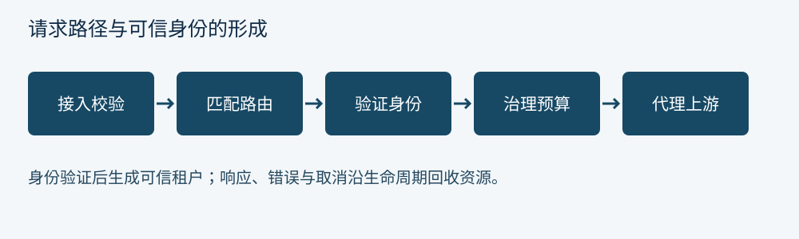

[← 前言：从一次请求走进网关](00-preface.md) · [全书目录](../README.md#全书目录) · [第 2 章 ShenYu 的模块地图与阅读方法 →](ch02.md)

---

# 第 1 章 网关边界与请求生命周期

## 1.1 先确定网关替谁解决问题

北向网关承接终端、合作伙伴或公网流量，处理统一入口、认证、配额和协议适配。东西向流量则发生在服务之间，常由客户端 SDK、服务网格或内部负载均衡器治理。两者可以共享基础设施，但信任边界和故障半径不同。把所有内部调用都绕到同一北向网关，会增加网络跳数和集中故障风险。

网关适合做跨服务、可复用且不需要深入业务事务的处理。例如验证令牌签名、提取可信租户、限制某个租户的请求速率。检查订单是否属于当前用户仍需业务服务完成，因为资源所有权需要业务数据。网关的认证结果不能代替服务的对象级授权。

我们把一次请求拆成接入、规范化、匹配、鉴权、治理、转发和响应七个阶段。实际实现可能重排某些阶段，但必须写出依赖：租户限流依赖可信身份，路由级指标依赖路由识别，请求体签名依赖明确的字节序列。没有依赖图，所谓插件顺序最终会成为隐含协议。

## 1.2 数据平面与控制平面

数据平面处理请求，控制平面管理路由和策略。请求路径不应为每次调用查询管理数据库。正常模式是控制平面发布配置，数据平面在本地维护可读取的状态。控制平面短暂不可用时，网关可以继续使用最近的有效配置；代价是配置新鲜度下降。

这不是说所有策略都能离线运行。分布式限流需要共享状态，令牌吊销可能依赖外部服务。应把每一种依赖的失效行为写清楚：继续放行、拒绝、使用本地降级额度，还是只保护高风险路由。全局的“失败放行”开关通常无法表达这些差异。

一次完整发布包括保存、校验、分发、应用与生效确认。管理界面显示“保存成功”，只证明其中很小一部分。后文用配置版本把这个过程连起来。

## 1.3 延迟、吞吐与在途请求

在稳定系统中，Little 定律给出平均在途数约等于到达率乘平均停留时间。假设每秒 2,000 个请求，平均停留 100 毫秒，平均在途约 200。若后端变慢到 2 秒而流量未降，在途可增长到约 4,000。连接池、堆内存和等待队列会一起承压。

因此网关不能只限制 QPS，还要限制并发和排队。速率限制控制到达速度，舱壁控制某个依赖占用的资源，超时控制资源持有时长。三者分别对应不同的控制对象。

**思考题。** 为什么“网关 CPU 只有 20%”不能证明系统还有充足容量？

---

[← 前言：从一次请求走进网关](00-preface.md) · [全书目录](../README.md#全书目录) · [第 2 章 ShenYu 的模块地图与阅读方法 →](ch02.md)
