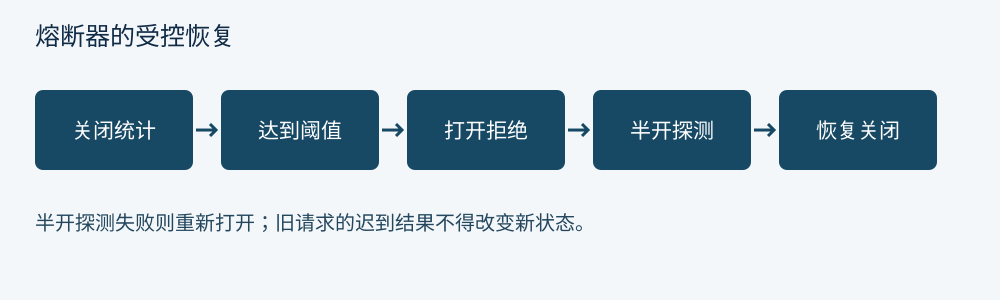

[← 第 6 章 限流：从令牌桶到租户配额](ch06.md) · [全书目录](../README.md#全书目录) · [第 8 章 动态配置：把发布当作分布式协议 →](ch08.md)

---

# 第 7 章 熔断、隔离、超时与重试

## 7.1 熔断器要回答三个问题

第一，什么算失败：连接错误、超时、特定状态码、慢调用，还是业务错误？第二，在多大的统计窗口与最小样本量下判断？第三，打开以后怎样恢复？将所有 4xx 算作后端失败，会让恶意请求触发熔断；把所有 5xx 排除又失去保护作用。

经典状态是关闭、打开、半开。关闭状态收集结果；达到阈值后打开，快速拒绝；等待一段时间进入半开，只允许少量探测；探测成功才恢复。没有半开并发限制，多实例同时恢复可能冲击刚刚恢复的服务。

熔断针对故障倾向，舱壁针对资源隔离。即使错误率低，某个慢接口也可能占满共享连接。按上游或业务等级设置并发舱壁，可以使支付缓慢时订单查询仍有资源。

## 7.2 超时是一条预算链

假设客户端总预算 1,000 毫秒。网关内部处理预留 50，网络与回写预留 100，剩余约 850 可供上游调用与可能的重试。若首次调用超时配置为 800，再重试一次 800，实际策略已经超出客户端预算。

连接建立、TLS 握手、响应头等待、流读取空闲与总处理时长是不同超时。流式响应持续到达数据时，空闲超时可能永远不触发，但总时长仍可能很长。应根据接口语义配置，不能让上传大文件与普通查询共享同一短总超时。

取消应传播到上游，以释放连接和计算资源；但客户端断开不证明后端事务没有完成。对于支付提交，客户端看到超时后必须查询结果或使用幂等键，不能直接推断失败。

## 7.3 重试可能放大故障

若三个层级各自最多尝试三次，最坏情况下底层会承受 27 次尝试。应明确哪一层有重试权，并限制总重试预算。只在可安全重复的操作上使用重试，写操作需依赖明确的幂等机制，而不是仅因为方法名叫 POST 就全部禁止或全部允许。

指数退避与抖动可以降低同步重试；剩余预算不足时应停止。重试指标必须区分原始请求与上游尝试，否则网关 QPS 不变而上游负载翻倍时难以解释。

熔断应统计逻辑请求还是每次尝试，也需要明确。每次尝试统计更贴近依赖健康，但同一请求会占多个样本；逻辑结果统计更贴近用户体验，却可能隐藏重试掩盖的故障。

## 7.4 降级结果必须有业务含义

缓存旧商品描述可能可接受，伪造“支付成功”不可接受。降级响应应有可识别的状态与来源，必要时返回可重试错误。静态兜底并非天然优于快速失败。读缓存也要说明陈旧上限与租户隔离，不能将其他用户的结果当作公共兜底。

**思考题。** 熔断器打开后错误率下降，是否说明后端已经恢复？

---

[← 第 6 章 限流：从令牌桶到租户配额](ch06.md) · [全书目录](../README.md#全书目录) · [第 8 章 动态配置：把发布当作分布式协议 →](ch08.md)
