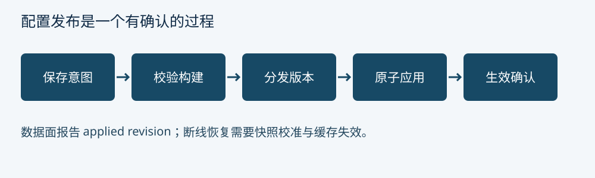

[← 第 7 章 熔断、隔离、超时与重试](ch07.md) · [全书目录](../README.md#全书目录) · [第 9 章 安全边界与协议处理 →](ch09.md)

---

# 第 8 章 动态配置：把发布当作分布式协议

## 8.1 一条配置经历了什么

ShenYu 的管理侧和运行侧通过同步机制传递数据；项目提供多种同步方式，具体可用模块以选定版本为准。WebSocket、HTTP 长轮询或协调存储等方式的差别不只是实时性，还包括断线恢复、全量校准、版本发现和部署复杂度。

不论采用哪一种方式，可靠设计都应表达以下状态：期望版本、接收版本、校验版本、应用版本以及生效时间。若管理侧只显示期望版本，无法判断某一网关实例是否仍在使用旧配置。

## 8.2 乱序、重复、断线与删除

网络消息可能重复和乱序。教学协议给每次发布分配单调递增的 revision，接收侧只应用更新版本。旧 revision 被忽略，重复 revision 幂等处理。若事件是增量，检测到缺口后需要全量拉取，不能简单跳到最高序号并假设中间变化不重要。

删除需要明确表示，不能把“消息里没有某对象”一律当作删除，因为消息可能只是部分更新。全量快照可用缺失表示删除，增量事件则需要删除类型或墓碑。恢复时还要防止旧快照把已删除对象复活。

版本号也不等于时间戳。不同节点时钟可能漂移；毫秒内多次修改可能碰撞。由单一发布事务或有一致性保证的序列生成 revision 更容易建立全序。

## 8.3 构建快照，然后原子切换

一个代理规则依赖上游、认证策略和限流参数。逐个修改共享 Map 时，请求可能读到“新路由配旧鉴权”。教学方案先在后台构建不可变快照：校验引用、预编译表达式、构建索引，再原子替换根引用。请求进入时捕获一个快照，整个生命周期使用该快照。

这是一种设计建议，不是对 ShenYu 所有缓存提供事务一致性的声明。前面看到的插件列表复制替换只保证那一列表引用的发布方式；多个缓存之间是否原子，需查看具体同步处理和插件实现。

大快照构建会产生瞬时双份内存和垃圾回收压力。可以采用分层不可变结构或按插件分区，但必须明确原子边界。不要为了省内存而让请求遍历一个正在修改的规则集合。

## 8.4 回滚与灰度发布

回滚应将旧内容以新 revision 重新发布，而不是把 revision 调低。这样既保留历史，也不破坏“只前进”的接收协议。灰度可按网关实例组、租户或流量比例进行，但配置变更自身不能依赖不可信请求头决定谁进入安全宽松版本。

发布门禁包括结构校验、引用完整性、路由冲突、鉴权覆盖、配额合法性和资源上限。发布后看应用确认、拒绝率、延迟分位数与配置版本分布。只看管理侧 HTTP 200 无法证明成功。

**思考题。** 为什么恢复数据库备份后，要特别检查配置版本与网关缓存？

---

[← 第 7 章 熔断、隔离、超时与重试](ch07.md) · [全书目录](../README.md#全书目录) · [第 9 章 安全边界与协议处理 →](ch09.md)
